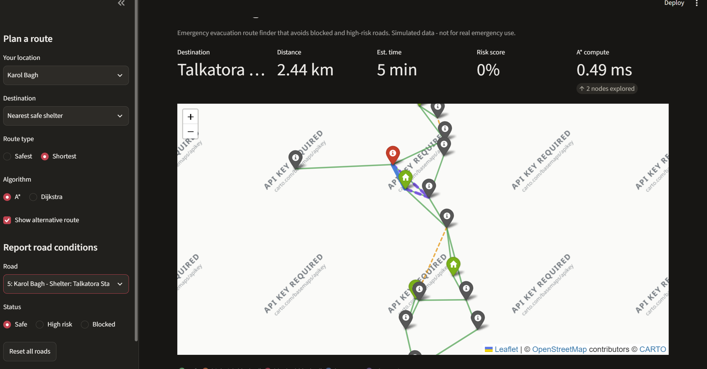
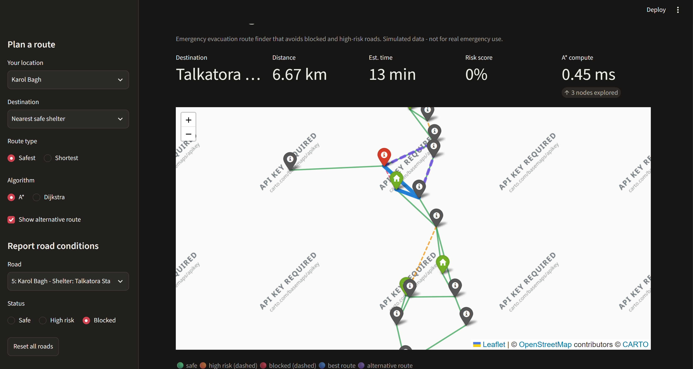

# 🚨 ResQRoute

Emergency evacuation route finder that avoids blocked and high-risk roads.

## Problem
In floods, fires and other emergencies, the shortest road to safety may be blocked or dangerous.
Most navigation tools optimise only for distance/time and do not let authorities or citizens
mark roads as hazardous and instantly re-plan.

## Solution
ResQRoute models a city as a weighted graph and uses **risk-aware Dijkstra and A\*** to compute
the shortest or the safest route to the nearest shelter. Roads can be marked *safe*, *high risk*
or *blocked*, and routes recalculate instantly.

`cost(road) = distance x (1 + riskWeight x penalty(status))` - blocked roads are skipped.
`riskWeight = 0` gives the shortest route; `riskWeight > 0` gives the safest.

## Features
- Shortest vs safest route (one algorithm, one tunable weight)
- Dijkstra vs A* (haversine heuristic) with live nodes-explored comparison
- Nearest-shelter finder across multiple shelters
- Alternative route (primary route's roads are penalised, then re-searched)
- Live road status editing with automatic recalculation
- Interactive map (Folium/Leaflet), risk score, ETA, dashboard
- "No safe route" detection when everything is cut off
- Automated tests (`python test_engine.py`)

## Screenshots



## Architecture
```
Streamlit UI (app.py) -> Graph + routing engine (engine.py) <- Simulated Delhi map (data.py)
```

## How to run
```bash
git clone https://github.com/ishika2605/ResQRoute.git
cd ResQRoute
pip install -r requirements.txt
python test_engine.py        # optional: run tests
streamlit run app.py         # opens http://localhost:8501
```

## Tech
Python, Streamlit, Folium (Leaflet), pandas, Dijkstra, A*, Haversine formula

## Limitations
Uses a simulated road network and hazards for central/south Delhi. Not for real emergency use.

## Future work
Real OpenStreetMap data, live hazard feeds (IMD/NDMA), C++ pathfinding core via pybind11,
multi-vehicle load balancing, SMS alerts, Docker deployment.
